# 次期ツール（フレームワーク）外部仕様書

|項目|内容|
|---|---|
|文書番号|900-xxx-xxx|
|プロジェクト名|次期ツール（フレームワーク）|
|対象製品|YCEStudio|
|対象バージョン|1.00|
|作成部門|（YRM開T）|
|機密区分|関係者外秘|
|発行日|2026-10-13|

## 承認

|役割|所属|氏名|日付|
|---|---|---|---|
|承認|（YRM開T）|福田|[YYYY-MM-DD]|
|照査|（YRM開T）|清水|[YYYY-MM-DD]|
|作成|（YRM開T）|畑中|[2026-07-01]|

## 改版履歴

| 版 | 日付 | 変更内容 | 作成者 | 承認者 |
|---|---|---|---|---|
| 1.0 | 2026/07/01 | 初版。<1.0-1>～<1.0-X>の変更を実施 | 畑中 | 福田 |
| 1.0-1 | 2026/07/01 | 新規作成 | 畑中 | - |

# 1. はじめに

## 1.1 本文書の位置付け

本文書は、次期ツールのフレームワークの外部仕様を定義するものである。

本文書では、利用者から見える機能、画面、操作、ファイルデータ、通信、メッセージおよびリソースに関する仕様を記載する。

本文書の対象範囲は以下のとおりとする。

- 対象製品: YCEStudio
- 対象機能: メイン画面、ツール画面、ドキュメント画面、ドキュメント保存確認画面およびMPE720連携
- 対象バージョン: 1.00
- 対象ユーザー: MPE720/YRM Studioを利用してST言語プログラムを操作するユーザ
- 対象外: クラス構成や内部実装方式の詳細（900-xxx-xxx_.mdを参照）

## 1.2 定義

本文書で使用する用語および略語を以下に示す。

| No. | 用語・略語 | 正式名称 | 定義・説明 |
|---:|---|---|---|
| 1 | YCEStudio | Yaskawa Controller Engineering Studio | 次期ツールのView側アプリケーション名 |
| 2 | YCEService | Yaskawa Controller Engineering Service | 次期ツールの制御側アプリケーション名 |

## 1.3 関連文書

本文書に関連する文書を以下に示す。

| No. | 文書名 | 文書番号 | 版 | 関係 |
|---:|---|---|---|---|
| 1 | 次期ツール（フレームワーク）内部仕様書 | 900-xxx-xxx | 1.00 | 内部仕様 |

# 2. 基本仕様

## 2.1 機能概要

メインメニューやドッキング機能を持つメイン画面と、ドッキング可能なツール画面およびドキュメント画面の基本機能を定義する。

### 2.1.1 目的

MPE720/YRM Studioから起動され、ST言語プログラムの表示・編集および関連操作を行うための共通画面と連携機能を提供する。

### 2.1.2 システム構成
MPE720/YRM StudioとYCEStudioはプロセス間通信で連携し、YCEStudioはYCEServiceを介してファイル操作およびコンパイルを要求する。

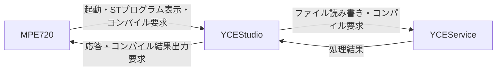
※CimScopeやDBとの連携はYCEServiceで行うため、本書の対象外。MPE720=FWXIDEを表す。

## 2.2 機能一覧

| 機能No. | 機能分類 | 機能名 | 機能概要 | 関連画面 |
|---|---|---|---|---|
| F-001 | UI | メイン画面 | メインメニューおよびドッキング領域を提供する | メイン画面 |
| F-002 | UI | ツール画面 | メイン画面の上下左右にドッキングできる | ツール画面 |
| F-003 | UI | ドキュメント画面 | メイン画面中央にドッキングして文書を表示する | ドキュメント画面 |
| F-004 | UI | ドキュメント保存確認 | 編集中ドキュメントの保存要否を確認する | ドキュメント保存確認画面 |

## 2.3 操作の流れ

## 2.3.1 ST言語プログラムの新規作成

| 手順 | 操作者 | 操作 | システムの動作 | 遷移先 |
|--------|--------|--------|--------|--------|
| 1 | ユーザ | (MPE720)ナビゲーションウィンドウからプログラムを新規作成する<br>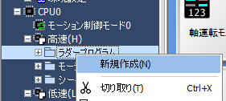 | プログラム新規作成画面を表示する | プログラム新規作成画面 |
| 2 | ユーザ | (MPE720)ST言語を選択して作成する<br>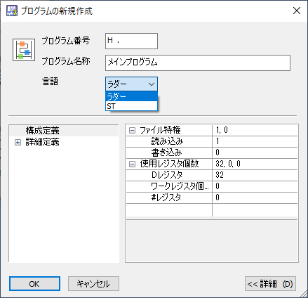 | ST言語プログラムを作成し、YCEStudioが起動していない場合、起動する<br>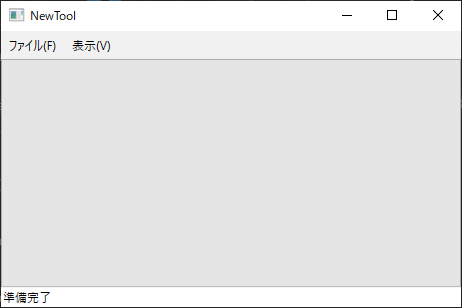 | YCEStudio |
| 3 | MPE720 | - | YCEStudioへドキュメント表示要求を送信する | - |
| 4 | YCEStudio | - | YCEServiceへファイルオープン要求を行う | - |
| 5 | YCEService | - | ファイルを読み込む | - |
| 6 | YCEStudio | - | ST言語プログラムを表示する<br>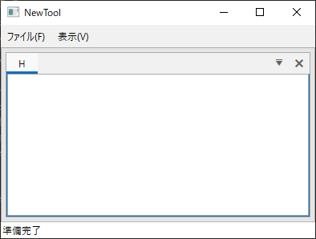 | ドキュメント画面 |

## 2.3.2 ST言語プログラムを開く

| 手順 | 操作者 | 操作 | システムの動作 | 遷移先 |
|--------|--------|--------|--------|--------|
| 1 | ユーザ | (MPE720)ナビゲーションウィンドウからST言語プログラムを開く<br>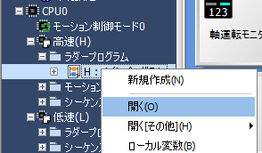 | YCEStudioが起動していない場合、起動する<br> | YCEStudio |
| 2 | MPE720 | - | YCEStudioへドキュメント表示要求を送信する | - |
| 3 | YCEStudio | - | YCEServiceへファイルオープン要求を行う | - |
| 4 | YCEService | - | ファイルを読み込む | - |
| 5 | YCEStudio | - | ST言語プログラムを表示する<br> | ドキュメント画面 |

## 2.3.3 ST言語プログラムを削除する

| 手順 | 操作者 | 操作 | システムの動作 | 遷移先 |
|--------|--------|--------|--------|--------|
| 1 | ユーザ | (MPE720)ナビゲーションウィンドウからST言語プログラムを削除する<br>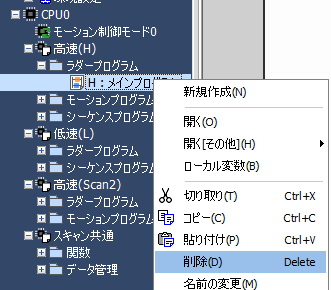 | 削除要求を行う | - |
| 2 | MPE720 | - | YCEStudioが起動中の場合：3へ<br>YCEStudioが起動していない場合：プログラムを削除する | - |
| 3 | MPE720 | - | YCEStudioへ削除対象プログラムの表示中確認要求を送信する | - |
| 4 | YCEStudio | - | MPE720へ表示中可否を応答する | - |
| 5 | MPE720 | - | 表示中の場合：削除不可メッセージを表示する<br>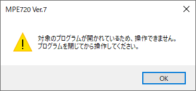<br>表示していない場合：プログラムを削除する | メッセージ |

## 2.3.4 ST言語プログラムのプロパティ

| 手順 | 操作者 | 操作 | システムの動作 | 遷移先 |
|--------|--------|--------|--------|--------|
| 1 | ユーザ | (MPE720)プログラムのプロパティを表示する<br>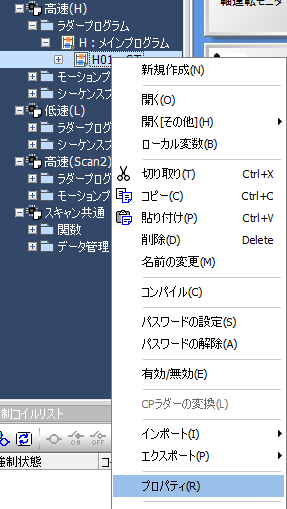 | プロパティ画面表示する | プロパティ画面 |
| 2 | MPE720 | - | プロパティ画面を表示する<br>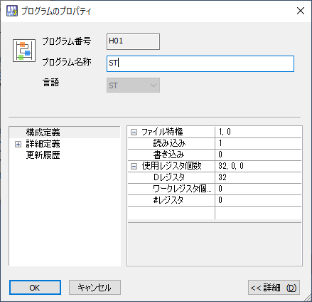 | - |

## 2.3.5 ST言語プログラムをコンパイルする<T.B.D>

| 手順 | 操作者 | 操作 | システムの動作 | 遷移先 |
|--------|--------|--------|--------|--------|
| 1 | ユーザ | (MPE720)ST言語プログラムをコンパイルする<br>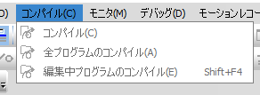 | YCEStudioが起動していない場合、起動する(最小化) | - |
| 2 | MPE720 | - | YCEStudioへコンパイル要求を行う | - |
| 3 | YCEStudio | - | YCEServiceへコンパイル要求を送信する | - |
| 4 | YCEService | - | コンパイル処理を実行し、YCEStudioへ応答する | - |
| 5 | YCEStudio | - | MPE720へ結果出力を応答する | - |
| 6 | MPE720 | - | 出力ウィンドウへコンパイル結果を表示する | 出力ウィンドウ |

### T.B.D
- ST言語エディタ側と要相談
- 印刷機能、差分表示、プロジェクト内検索／置換、クロスリファレンス等との連携については要検討

# 3. 外部仕様

## 3.1 画面一覧

| 画面No. | 画面名 | 画面種別 | 概要 | 呼出元 | 遷移先 | 新規/変更 |
|---|---|---|---|---|---|---|
| 1 | メイン画面 | メイン | メインメニューおよびドッキング領域を持つ | MPE720/YRM Studio | ツール画面、ドキュメント画面 | 新規 |
| 2 | ツール画面 | ツール | 上下左右にドッキング可能な画面 | メイン画面 | - | 新規 |
| 3 | ドキュメント画面 | ドキュメント | メイン画面中央に表示する画面 | メイン画面 | - | 新規 |
| 4 | ドキュメント保存確認画面 | ダイアログ | 編集中ドキュメントの保存確認画面 | メイン画面 | 呼出元画面 | 新規 |
| 5 | ラダープログラム作成、プロパティ画面 | ダイアログ | ST言語の選択およびプログラムプロパティ表示 | MPE720/YRM Studio | MPE720/YRM Studio | 変更 |

## 3.2 画面詳細

### 3.2.1 メイン画面

#### 3.2.1.1 画面構成

##### 画面イメージ

- メイン画面
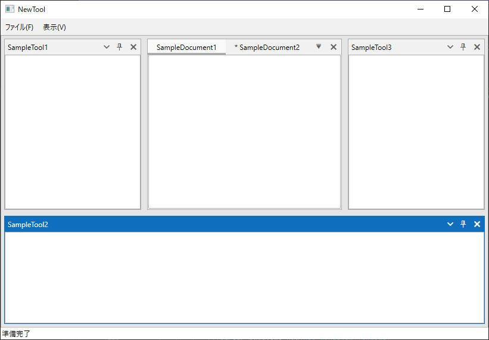

- ドッキング中画面
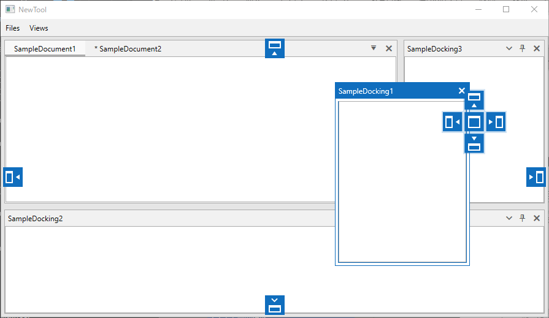

- ビジー画面
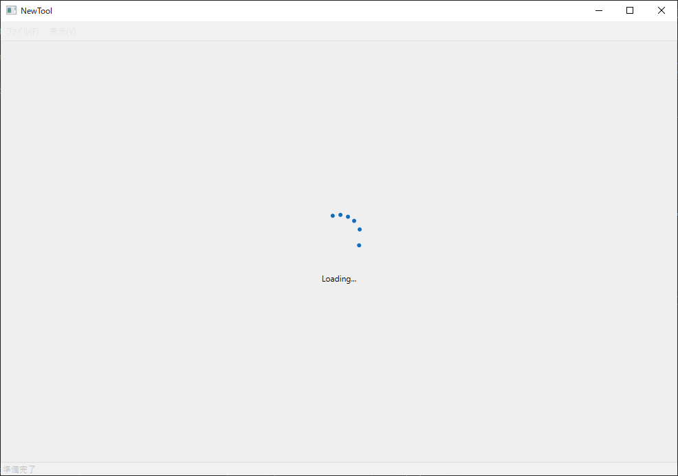

##### 画面レイアウト

| 領域No. | 領域名 | 概要 | コンテキストメニューNo. |
| --- | --- | --- | --- |
| 1 | アイコン | アプリケーションのアイコン | 3.2.1.4.1 |
| 2 | タイトル | アプリケーション名 | 同上 |
| 3 | 最小化 | アプリケーションを最小化する | 同上 |
| 4 | 最大化/元に戻す | アプリケーションを最大化/元に戻す | 同上 |
| 5 | × | アプリケーションを閉じる | - |
| 6 | メニュー | メインメニュー | - |
| 7 | ドッキングエリア | ツール画面、ドキュメント画面を表示するエリア | - |
| 8 | ドッキングコンパス | ツール画面、ドキュメント画面をドラッグ&ドロップする際に表示し、ドッキングするエリアを選択する | - |
| 9 | ステータスバー | ステータスを表示する | - |
| 10 | ビジーインディケーター | ビジー状態を表示する | - |

#### 3.2.1.2 メニューバー

<T.B.D>必要な機能があれば追加する。ツール画面の表示/非表示メニューなど。

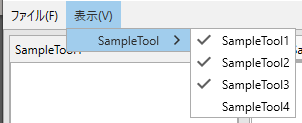

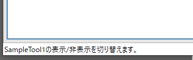

| No. | 第1階層 | 第2階層 | 第3階層 | ショートカット | 有効条件 | 選択時の動作 |
|---:|---|---|---|---|---|---|
| 1 |  |  |  |  |  |  |

メニューがハイライトされた場合、ステータスバーにメニュー説明を表示する。

#### 3.2.1.3 コントロール仕様

##### コントロール一覧
| No. | コントロール名 | 種別 | 表示内容・用途 | 初期値 | 入出力 | 有効条件 | 表示条件 | リソースNo. |
|---:|---|---|---|---|---|---|---|---|
| 1 | アイコン | アイコン | アプリケーションのアイコン | - | 出力 | 常時無効 | 常時表示 | RES-001 |
| 2 | タイトル | タイトル | アプリケーション名。起動引数がある場合は「{タイトル} {プロジェクトファイル名} [{機種名}]」 | 起動引数に従う | 出力 | 常時無効 | 常時表示 | RES-002 |
| 3 | 最小化 | ボタン | アプリケーションを最小化する | - | 入力 | 常時有効 | 常時表示 | - |
| 4 | 最大化/元に戻す | ボタン | アプリケーションを最大化/元に戻す<br>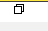 | - | 入力 | 常時有効 | 常時表示 | - |
| 5 | × | ボタン | アプリケーションを閉じる | - | 入力 | 常時有効 | 常時表示 | - |
| 6 | メニュー | メニュー(telerik) | メインメニューを表示する | - | 入出力 | 常時有効 | 常時表示 | - |
| 7 | ドッキングエリア | ドッキング(telerik) | ツール画面、ドキュメント画面を表示する | - | 入出力 | 常時有効 | 常時表示 | - |
| 8 | ドッキングコンパス | ドッキングコンパス(telerik) | ドッキング先を選択する | - | 入力 | 画面をドラッグ中 | ドッキング可能な画面をドラッグ中 | - |
| 9 | ステータスバー | ステータスバー | オンライン情報やCPU状態などを表示する（T.B.D） | - | 出力 | 常時無効 | 常時表示 | 3 |
| 10 | ビジーインディケーター | ビジーインディケーター(telerik) | 初期化などのビジー状態を表示し、表示中は画面操作を無効にする | 初期化中 | 出力 | 常時無効 | ビジー状態時 | - |

###### ドッキングコンパスの表示/非表示

- ツール画面をドラッグした場合
  - 上下左右、ツールエリア内の上下左右、ツールエリア内に追加が可能。
  - ドキュメントエリアにはドッキング不可。
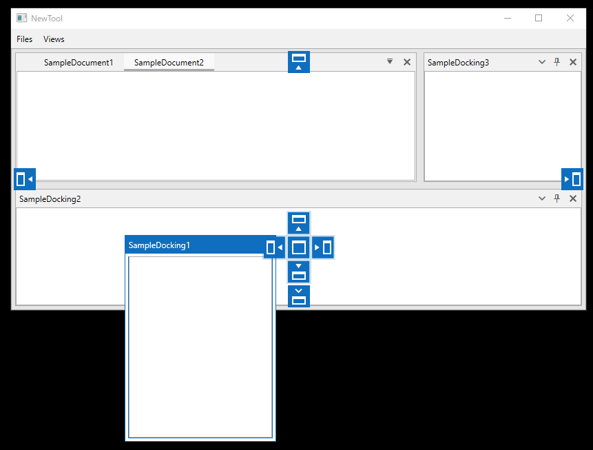

- ドキュメント画面をドラッグした場合
  - ドキュメントエリア内の上下左右、ドキュメントエリア内に追加が可能。
  - ツールエリアにはドッキング不可。
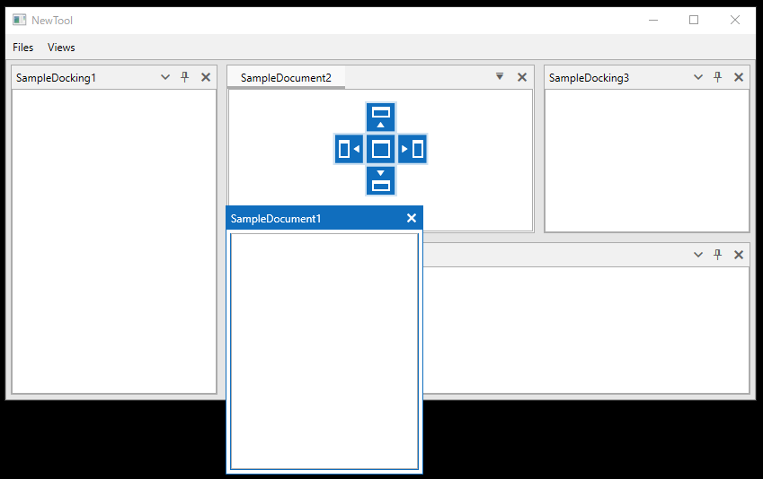

##### マウス操作

| No. | マウス操作 | 対象 | 動作 | 有効条件 |
|---:|---|---|---|---|
| 1 | クリック | 画面 | 選択する | 有効 |
| 2 | ダブルクリック | 画面ヘッダー | ウィンドウを最大化/元に戻す | 有効 |
| 3 | 右クリック | 画面ヘッダー | コンテキストメニューを表示する | 有効 |
| 4 | ドラッグ | ツール画面またはドキュメント画面のヘッダー | ドッキング画面を移動する | 有効 |
| 5 | ドロップ | ドッキング領域 | ドラッグ中の画面を配置する | 有効 |

##### キーボード操作

| No. | キー操作 | 対象 | 動作 | 有効条件 |
|---:|---|---|---|---|
| 1 | Enter | メイン画面 | 割当なし | 無効 |
| 2 | Delete | メイン画面 | 割当なし | 無効 |
| 3 | BackSpace | メイン画面 | 割当なし | 無効 |
| 4 | Ctrl + X | メイン画面 | 割当なし | 無効 |
| 5 | Ctrl + C | メイン画面 | 割当なし | 無効 |
| 6 | Ctrl + V | メイン画面 | 割当なし | 無効 |
| 7 | Ctrl + Z | メイン画面 | 割当なし | 無効 |
| 8 | Ctrl + N | メイン画面 | 割当なし | 無効 |

#### 3.2.1.4 コンテキストメニュー

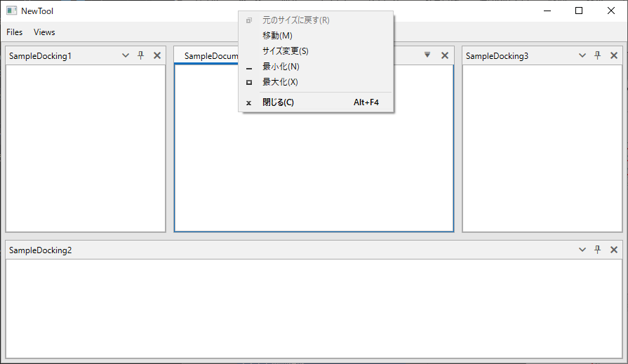

| No. | 対象 | メニュー項目 | ショートカット | 表示条件 | 有効条件 | 選択時の動作 |
|---:|---|---|---|---|---|---|
| 1 | ウィンドウタイトルバー | Windows標準コンテキストメニュー | - | 右クリック時 | 常時 | Windows標準機能のため詳細は省略する |

#### 3.2.1.5 内部処理（状態遷移、シーケンス）

##### 起動引数

- MPE720/YRM Studioから起動される際、以下の起動引数を指定する。
- 起動引数は、”/{key1}={value1} /{key2}={value2}…”のフォーマットとする。

| No. | キー | 備考 |
| --- | --- | --- |
| 1 | ProjectFilePath | プロジェクトのファイルパスオフライン、またはプロジェクトリンク接続時のみ使用 |
| 2 | CPU | 機種名(MPX1312-2など) |
| 3 | LANG | 言語情報(0411など) |
| 4 | ProcessId | 起動元のプロセスId |
| 5 | LINKEDMOTIONFACTORYID | プロジェクトリンクモーションファクトリIDプロジェクトリンク時のみ使用※View側では使用しない。gRPCに渡す。 |
| 6 | MOTIONFACTORYID | モーションファクトリID※View側では使用しない。gRPCに渡す。 |
| 7 | ONLINE | オンライン情報(1:オンライン、左記以外:オフライン) |
| 8 | IsMinimized | 画面を最小化状態にするか(コンパイルなどで画面表示不要でgRPC側の機能のみ使いたい際に使用する) |

##### プロセス間通信
- MPE720/YRM StudioとYCEStudio間の通信を行う。
- Win32APIのWM_COPYDATAをSendMessageで通知を行う。
- 要求/応答データはWindows共有メモリで行う。
- 応答待ち/処理完了はWindowsEventで行う。
- 共有メモリ名：Yaskawa.ControllerEngineeringStudio[{送信先のプロセスID}]_{MessageID}
- イベント名：Yaskawa.ControllerEngineeringStudio [{送信先のプロセスID}]_{MessageID}_Event

※WM_COPYDATAのCOPYDATASTRUCTのlpData、cbDataは送信元のプロセスID固定とする。

- MPE720/YRM Studio→YCEStudio

| No. | メッセージ | 備考 |
| --- | --- | --- |
| 1 | アプリケーション準備完了確認 | YCEStudio側がSendmessageの処理を行える状態かを確認する |
| 2 | アプリケーション終了可否確認 | MPE720/YRMStudioが終了する際、アプリケーションを終了しても良いかを確認する |
| 3 | ドキュメント表示要求 | ドキュメントの表示を行う<T.B.D>ドキュメントジャンプも本メッセージで行う |
| 4 | ドキュメント表示中確認 | ドキュメントが表示中か確認を行う |
| 5 | コンパイル要求 | コンパイルの要求を行う |
※アプリケーションの終了は、WM_CLOSEメッセージによって行われる。

- YCEStudio→MPE720/YRM Studio
<T.B.D>YCEStudio側から要求することはある？コンパイル結果の出力など？

| No. | メッセージ | 備考 |
| --- | --- | --- |
| 1 |   |   |
| 2 |   |   |

例：ドキュメント表示要求時の処理フロー
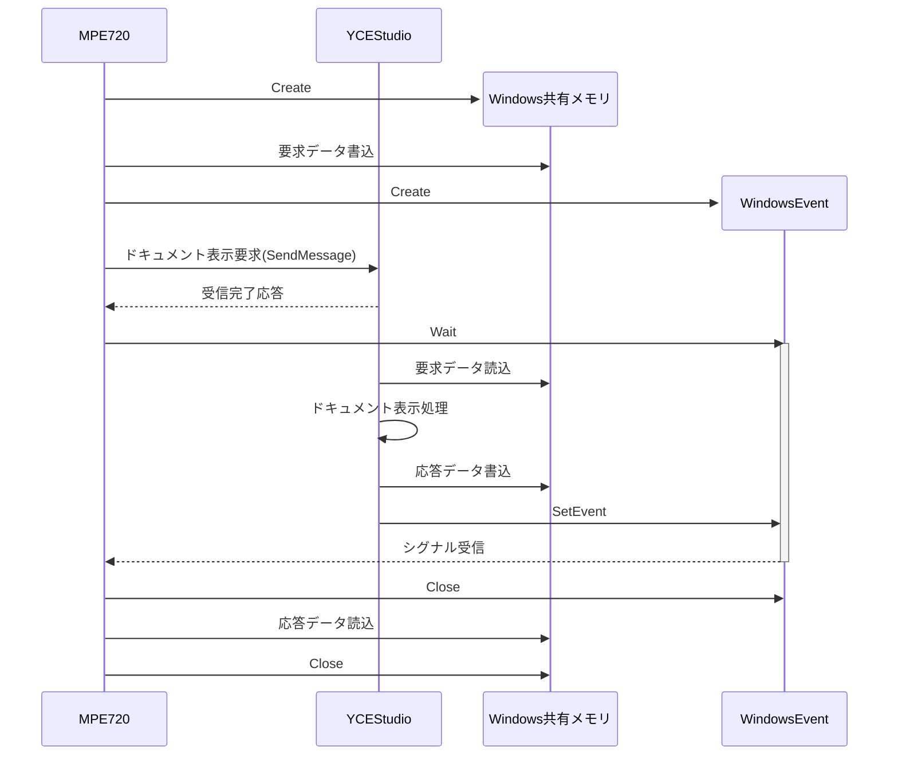

##### YCEService連携

- YCEStudioとYCEService間は、gRPCを使用して通信する。
- 通信路はTCPではなくWindows Named Pipeを使用する。
- Named Pipe名は`Yaskawa.MPE720.ControllerEngineeringService`とする。(YRMStudioの場合、MPE720を置き換え)
- gRPCチャネルは`http://localhost`で生成し、HTTPハンドラの`ConnectCallback`でNamed Pipeへ接続する。
- YCEStudio起動時に、DIコンテナへ各gRPCクライアントをSingleton登録する。

| No. | クライアント | 用途 |
| --- | --- | --- |
| 1 | `ServerGrpcServiceClient` | YCEServiceの起動確認、バージョン確認 |
| 2 | `ClientGrpcServiceClient` | クライアント接続開始/終了、Heartbeat |

- 上記以外にもgRPCクライアントが増えた場合にも、同様にDIコンテナへSingleton登録する。

##### YCEService接続開始/終了

- メイン画面のロード時、YCEStudioは`StartEngineeringAsync`を実行し、YCEServiceとの接続を開始する。
- 接続開始時は以下の順序で処理する。
  1. `ServerGrpcService.GetVersion`でYCEService起動済みか確認する。
  2. 未起動の場合、`Yaskawa.ControllerEngineeringService.exe`を起動する。
  3. 起動後、最大30秒間、300ms周期で起動完了を待機する。
  4. `ClientGrpcService.AddClient`を実行し、`SessionHandle`を取得する。
  5. 起動引数から取得した`ONLINE`、`MOTIONFACTORYID`などをコンテキストへ保持する。
  6. 30秒周期のHeartbeatを開始する。
- YCEStudio終了時は`ClientGrpcService.RemoveClient`を実行し、`SessionHandle`を解放する。
- Heartbeat停止後にクライアント切断を行う。
- `SessionHandle`未存在で`RemoveClient`が失敗した場合、`SessionHandleNotFound`は正常系として扱う。

##### YCEService連携で保持するコンテキスト

- YCEStudioはYCEService連携用に以下の情報を保持する。

| 項目 | 内容 |
| --- | --- |
| SessionHandle | `AddClient`で取得したクライアント接続識別子 |
| IsOnline | 起動引数`ONLINE`から取得したオンライン状態 |
| MotionFactoryId | 起動引数`MOTIONFACTORYID`から取得したモーションファクトリID |
| PortNo | YCEService接続時に指定するポート番号 |
| IPAddress | YCEService接続時に指定するIPアドレス |

##### サンプル画面でのYCEService連携

- MPE720からのドキュメント表示要求を受信すると、YCEStudioは対象ファイル名をキーとしてドキュメント画面を開く。
- ドキュメント画面生成時、`IStProgramService.StartEngineeringAsync(プログラム名)`を実行し、STプログラム用の`EngineeringHandle`を取得する。
- `EngineeringHandle`取得成功時、`LadderProgGetProperty`を呼び出してプログラムコメントを取得し、ドキュメントタイトルへ反映する。
- ドキュメント画面破棄時、`EndEngineeringAsync`を実行し、STプログラム用の`EngineeringHandle`を解放する。
- YCEServiceとの接続に失敗した場合でも、画面確認を優先するため、現実装ではドキュメント画面の生成自体は継続する。

##### 実装上の補足

- gRPC呼び出しで発生した`RpcException`は共通基底クラスで補足し、戻り値`GrpcResult`へ変換する。
- `StatusCode.Cancelled`はキャンセルとして扱い、それ以外はTrailerの`error-code`から業務エラーコードを取得する。

##### ドキュメントの保存確認

アプリケーションの終了やMPE720/YRMStudioから要求があった場合に、ドキュメントの保存確認メッセージを表示する。
- アプリケーションの終了
- MPE720/YRMStudioを終了する
- MPE720/YRMStudioでオフラインからプロジェクトリンク接続する
- MPE720/YRMStudioでプロジェクトリンク接続からオフラインに変更する
- MPE720/YRMStudioでプロジェクトを閉じる/オンライン切断する
- オフラインプロジェクトの保存
- 転送で書き込みを行う前

※転送で読み込みを行う場合は、アプリケーションは強制終了されるため、確認メッセージは表示しない。


- 保存：各ドキュメントを保存し、アプリケーションを終了する。
- 保存しない：保存せずにアプリケーションを終了する。
- キャンセル：アプリケーションの終了をキャンセルする。

画面詳細は、「3.2.4ドキュメント保存確認画面」を参照。

##### レイアウトの保存/復元

- ツール画面のドッキング状態(表示/非表示、位置など)は、アプリケーション終了時に保存し、アプリケーション起動時に復元する。
- `C:\Users\○○\AppData\Local\YASKAWA\Yaskawa.ControllerEngineeringStudio`配下に`dockingLayout.xml`を保存する。
  - telerikのRadDockingのSave/LoadLayout機能。Xml形式でDocking情報が書き込まれる。

```xml
<?xml version="1.0" encoding="utf-8"?>
<RadDocking>
  <DocumentHost>
    <RadSplitContainer>
      <Items>
        <RadPaneGroup SerializationTag="DocumentGroup" SelectedIndex="0">
          <Items>
          </Items>
        </RadPaneGroup>
      </Items>
    </RadSplitContainer>
  </DocumentHost>
  <SplitContainers>
    <RadSplitContainer
      Dock="DockedTop"
      Height="180"
      RelativeWidth="100"
      RelativeHeight="100"
      IsAutoGenerated="True">
      <Items>
        <RadPaneGroup
          RelativeWidth="100"
          RelativeHeight="100"
          IsAutoGenerated="True"
          SelectedIndex="0">
          <Items>
            <RadPane
              SerializationTag="{&quot;DockingId&quot;:1,&quot;Key&quot;:&quot;SampleTool3&quot;}"
              IsDockable="True" />
          </Items>
        </RadPaneGroup>
      </Items>
    </RadSplitContainer>
    <RadSplitContainer
      Dock="DockedRight"
      Width="240"
      RelativeWidth="100"
      RelativeHeight="100"
      IsAutoGenerated="True">
      <Items>
        <RadPaneGroup
          RelativeWidth="100"
          RelativeHeight="100"
          IsAutoGenerated="True"
          SelectedIndex="0">
          <Items>
            <RadPane
              SerializationTag="{&quot;DockingId&quot;:1,&quot;Key&quot;:&quot;SampleTool4&quot;}"
              IsDockable="True" />
          </Items>
        </RadPaneGroup>
      </Items>
    </RadSplitContainer>
    <RadSplitContainer
      Dock="DockedLeft"
      Width="240">
      <Items>
        <RadPaneGroup
          SerializationTag="LeftGroup"
          SelectedIndex="0">
          <Items>
            <RadPane
              SerializationTag="{&quot;DockingId&quot;:1,&quot;Key&quot;:&quot;SampleTool1&quot;}"
              IsDockable="True" />
          </Items>
        </RadPaneGroup>
        <RadPaneGroup
          RelativeWidth="100"
          RelativeHeight="100"
          IsAutoGenerated="True"
          SelectedIndex="0">
          <Items>
            <RadPane
              SerializationTag="{&quot;DockingId&quot;:1,&quot;Key&quot;:&quot;SampleTool2&quot;}"
              IsDockable="True" />
          </Items>
        </RadPaneGroup>
      </Items>
    </RadSplitContainer>
    <RadSplitContainer
      Dock="DockedRight"
      Width="240">
      <Items>
        <RadPaneGroup
          SerializationTag="RightGroup"
          SelectedIndex="-1">
          <Items />
        </RadPaneGroup>
      </Items>
    </RadSplitContainer>
    <RadSplitContainer
      Dock="DockedBottom"
      Height="180">
      <Items>
        <RadPaneGroup
          SerializationTag="BottomGroup"
          SelectedIndex="-1">
          <Items />
        </RadPaneGroup>
      </Items>
    </RadSplitContainer>
  </SplitContainers>
</RadDocking>
```

- RadPaneのSerializationTagには、ツール画面を表示するために必要な情報を持つ。
- これにより、以下の手順でレイアウトの復元を行う。
  1. dockingLayout.xmlを読み込み
  2. 各RadPaneのSerializationTagからViewModelを復元(ツール画面表示処理)  
この時点では、ツール画面は、初期位置となる。
  3. RadDockingでdockingLayout.xmlを使用し、Viewを復元  
2.で表示されているツール画面の位置が復元される。

※TelerikのRadDockingのレイアウト保存/復元処理はViewを基準としているため、機能をそのまま使用すると、ViewModelが復元されない。そのため、ViewModelを独自に復元し、Viewの位置復元のみTelerikの機能に任せる。

##### ドッキング画面の表示/非表示
- ツール画面  
非表示：ViewModelは維持する。  
表示：初回のみ、ViewModel、Viewを生成する。2回目以降は、前回の状態で表示する。

- ドキュメント画面  
非表示：ViewModelは破棄する。  
表示：毎回、ViewModel、Viewを生成する。

#### 3.2.1.6 メッセージ
本画面固有のメッセージは定義しない。ドキュメント保存確認は3.2.4を参照。

#### 3.2.1.7 リソース

| リソースID | 使用箇所 | 日本語 | 英語 | 簡体字 | 備考 |
|---|---|---|---|---|---|
| RES-001 | アプリケーションアイコン | <T.B.D>アイコン |  |  | アイコン未確定 |
| RES-002 | ツール名 | <T.B.D>ツール名 |  |  | 表示名未確定 |
| RES-003 | ステータスバー | 準備完了 | Ready |  |  |

### 3.2.2 ツール画面

#### 3.2.2.1 画面構成

##### 画面イメージ

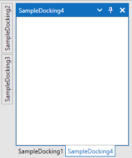

##### 画面レイアウト

| 領域No. | 領域名 | 概要 | コンテキストメニューNo. |
| --- | --- | --- | --- |
| 1 | タイトル | ツール画面のタイトル | 3.3.2.4 |
| 2 | V | コンテキストメニューを表示する | 同上 |
| 3 | Auto hide | ツール画面を自動で隠す | 同上 |
| 4 | × | ツール画面を非表示にする | 同上 |
| 5 | Auto hideエリア | 自動で隠している画面のタイトル | 同上 |
| 6 | タブ | 表示しているツール画面のタブ | 同上 |
| 7 | 機能エリア | 各機能の画面 | - |

#### 3.2.2.2 メニューバー
この画面固有のメニューバーは設けない。

#### 3.2.2.3 コントロール仕様

| No. | コントロール名 | 種別 | 表示内容・用途 | 初期値 | 入出力 | 有効条件 | 表示条件 | リソースNo. |
|---:|---|---|---|---|---|---|---|---|
| 1 | タイトル | タイトル | ツール画面のタイトル | - | 出力 | 常時無効 | 常時表示 | - |
| 2 | V | ボタン | コンテキストメニューを表示する | - | 入力 | 常時有効 | 常時表示 | - |
| 3 | Auto hide | ボタン | ツール画面を自動で隠す/隠さないを設定する | 現在の状態 | 入出力 | 常時有効 | 常時表示 | - |
| 4 | × | ボタン | ツール画面を非表示にする | - | 入力 | 常時有効 | 常時表示 | - |
| 5 | Auto hideエリア | タブ | 自動で隠している画面のタイトルを表示する | - | 入出力 | 常時有効 | Auto hide状態 | - |
| 6 | タブ | タブ | 表示しているツール画面を切り替える | - | 入出力 | 常時有効 | Auto hideでない状態 | - |
| 7 | 機能エリア | - | 各機能の画面を表示する | - | 出力 | - | 常時表示 | - |

##### マウス操作

| No. | マウス操作 | 対象 | 動作 | 有効条件 |
|---:|---|---|---|---|
| 1 | クリック | ツール画面 | 選択する | 有効 |
| 2 | ダブルクリック | 画面ヘッダー（フローティング時） | ウィンドウを最大化/元に戻す | 有効 |
| 3 | 右クリック | ツール画面 | コンテキストメニューを表示する | 有効 |
| 4 | ドラッグ | ツール画面 | ドッキング画面を移動する | 有効 |
| 5 | ドロップ | ドッキング領域 | ドラッグ中の画面を配置する | 有効 |

##### キーボード操作

| No. | キー操作 | 対象 | 動作 | 有効条件 |
|---:|---|---|---|---|
| 1 | Enter | ツール画面 | 割当なし | 無効 |
| 2 | Delete | ツール画面 | 割当なし | 無効 |
| 3 | BackSpace | ツール画面 | 割当なし | 無効 |
| 4 | Ctrl + X | ツール画面 | 割当なし | 無効 |
| 5 | Ctrl + C | ツール画面 | 割当なし | 無効 |
| 6 | Ctrl + V | ツール画面 | 割当なし | 無効 |
| 7 | Ctrl + Z | ツール画面 | 割当なし | 無効 |
| 8 | Ctrl + N | ツール画面 | 割当なし | 無効 |

#### 3.2.2.4 コンテキストメニュー

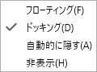

| No. | 対象 | メニュー項目 | ショートカット | 表示条件 | 有効条件 | 選択時の動作 |
|---:|---|---|---|---|---|---|
| 1 | ツール画面 | フローティング | F | 右クリック時 | Auto hideでない場合 | チェックを外すとFloating状態へ遷移する。チェック済み状態での選択は何もしない |
| 2 | ツール画面 | ドッキング | D | 右クリック時 | Auto hideでない場合 | チェックを外すとDockable状態へ遷移する。チェック済み状態での選択は何もしない |
| 3 | ツール画面 | 自動的に隠す | A | 右クリック時 | ツール画面かつFloatingでない場合 | チェックするとAuto hide状態へ遷移する、チェックを外すとDockable状態へ遷移する |
| 4 | ツール画面 | 非表示 | H | 右クリック時 | 常時有効 | 画面を非表示にする |

#### 3.2.2.5 内部処理（状態遷移、シーケンス）
##### 状態一覧

| 状態No. | 状態名 | 状態の説明 | 画面表示 | 操作可否 |
|---|---|---|---|---|
| ST-001 | Floating | 単一のウィンドウで、ドッキング不可 | 独立ウィンドウ<br>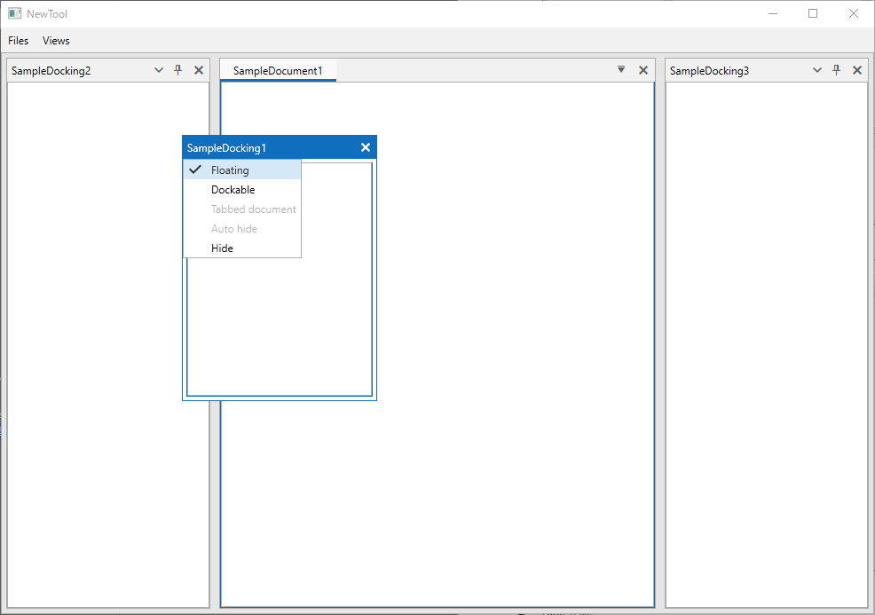 | 可 |
| ST-002 | Dockable | ドッキング可能な状態 | ドッキング領域またはフローティング<br>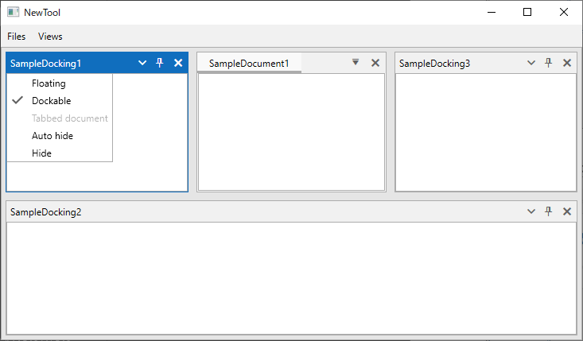 | 可 |
| ST-003 | Auto hide | 自動的に隠し、領域選択時にポップアップする状態 | ドッキング領域のタブ<br>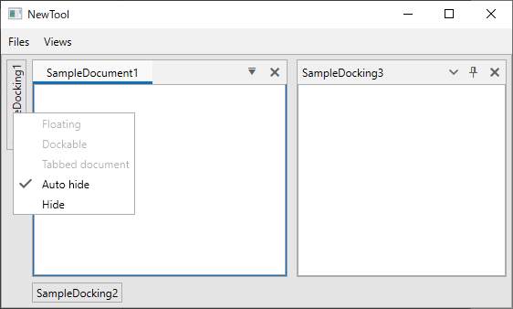 | 可 |
| ST-004 | Hide | 画面が非表示の状態 | 非表示 | 不可 |

##### 状態遷移

| No. | 遷移前状態 | イベント | ガード条件 | 処理 | 遷移後状態 |
|---:|---|---|---|---|---|
| 1 | Dockable | フローティングを選択 | 常時 | 画面を独立ウィンドウにする | Floating |
| 2 | Floating | ドッキングを選択 | 常時 | ドッキング可能にする | Dockable |
| 3 | Dockable | 自動的に隠すを選択 | Floatingでない | ドッキング領域に自動表示する | Auto hide |
| 4 | Auto hide | 自動的に隠すを解除 | Floatingでない | ドッキング表示に戻す | Dockable |
| 5 | 表示中 | 非表示を選択 | 常時 | 画面を非表示にする | Hide |

##### 処理シーケンス

| 手順 | 実行主体 | 処理 | 入力 | 出力 | 異常時の動作 |
|---:|---|---|---|---|---|
| 1 | ユーザー | ツール画面のヘッダーをドラッグする | 対象画面 | ドッキングコンパス | - |
| 2 | ユーザー | ドッキング先へドロップする | ドッキング先 | 配置されたツール画面 | ドッキング不可領域には配置できない |

#### 3.2.2.6 メッセージ

この画面固有のメッセージはなし。

#### 3.2.2.7 リソース

| リソースID | 使用箇所 | 日本語 | 英語 | 簡体字 | 備考 |
|---|---|---|---|---|---|
| RES-001 | コンテキストメニュー | フローティング(_F) | _Floating | 悬浮(_F) |  |
| RES-002 | コンテキストメニュー | ドッキング(_D) | _Dockable | 停靠(_D) |  |
| RES-003 | コンテキストメニュー | 自動的に隠す(_A) | _Auto Hide | 自动隐藏(_A) |  |
| RES-004 | コンテキストメニュー | 非表示(_H) | _Hide | 隐藏(_H) |  |

### 3.2.3 ドキュメント画面

#### 3.2.3.1 画面構成

##### 画面イメージ

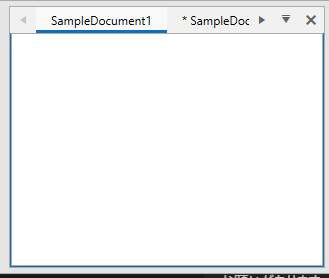

##### 画面レイアウト

| 領域No. | 領域名 | 概要 | コンテキストメニューNo. |
| --- | --- | --- | --- |
| 1 | タブ | ドキュメント画面のタブ | 3.2.3.4 |
| 2 | 水平スクロール | ドキュメント画面のタブの水平スクロール | 同上 |
| 3 | ▼ | ドキュメント画面一覧を表示する | 同上 |
| 4 | × | ドキュメント画面を閉じる | 同上 |
| 5 | 機能エリア | 各機能の画面 | - |

#### 3.2.3.2 メニューバー
この画面固有のメニューバーは設けない。

#### 3.2.3.3 コントロール仕様

| No. | コントロール名 | 種別 | 表示内容・用途 | 初期値 | 入出力 | 有効条件 | 表示条件 | リソースNo. |
|---:|---|---|---|---|---|---|---|---|
| 1 | タブ | タブ | 開いているドキュメント画面を表示する。編集状態の場合は「* {タイトル}」とする | - | 出力 | 常時無効 | 常時表示 | - |
| 2 | 水平スクロール◀▶ | スクロール | 表示タブを水平スクロールする | - | 入力 | スクロール可能な場合 | タブが全て表示できない場合 | - |
| 3 | ▼ | ボタン | 開いているドキュメント一覧を表示し、選択した画面をアクティブにする<br>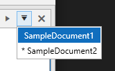 | - | 入出力 | 常時有効 | 常時表示 | - |
| 4 | × | ボタン | ドキュメント画面を閉じる | - | 入力 | 常時有効 | 常時表示 | - |
| 5 | 機能エリア | - | 各機能の画面を表示する | - | 出力 | - | 常時表示 | - |

##### マウス操作

| No. | マウス操作 | 対象 | 動作 | 有効条件 |
|---:|---|---|---|---|
| 1 | クリック | ドキュメント画面 | 選択する | 有効 |
| 2 | ダブルクリック | 画面ヘッダー（フローティング時） | ウィンドウを最大化/元に戻す | 有効 |
| 3 | 右クリック | ドキュメント画面 | コンテキストメニューを表示する | 有効 |
| 4 | ドラッグ | ドキュメント画面 | ドッキング画面を移動する | 有効 |
| 5 | ドロップ | ドッキング領域 | ドラッグ中の画面を配置する | 有効 |

##### キーボード操作

| No. | キー操作 | 対象 | 動作 | 有効条件 |
|---:|---|---|---|---|
| 1 | Enter | ドキュメント画面 | 割当なし | 無効 |
| 2 | Delete | ドキュメント画面 | 割当なし | 無効 |
| 3 | BackSpace | ドキュメント画面 | 割当なし | 無効 |
| 4 | Ctrl + X | ドキュメント画面 | 割当なし | 無効 |
| 5 | Ctrl + C | ドキュメント画面 | 割当なし | 無効 |
| 6 | Ctrl + V | ドキュメント画面 | 割当なし | 無効 |
| 7 | Ctrl + Z | ドキュメント画面 | 割当なし | 無効 |
| 8 | Ctrl + N | ドキュメント画面 | 割当なし | 無効 |

#### 3.2.3.4 コンテキストメニュー

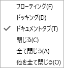

| No. | 対象 | メニュー項目 | ショートカット | 表示条件 | 有効条件 | 選択時の動作 |
|---:|---|---|---|---|---|---|
| 1 | ドキュメント画面 | フローティング | H | 右クリック時 | 常時有効 | チェックを付けるとFloating状態へ遷移する。 |
| 2 | ドキュメント画面 | ドッキング | D | 右クリック時 | 常時有効 | チェックを付けるとDockable状態へ遷移する。 |
| 3 | ドキュメント画面 | ドキュメントタブ | T | 右クリック時 | 常時有効 | チェックを付けるとTabbed document状態へ遷移する。 |
| 4 | ドキュメント画面 | 閉じる | C | 右クリック時 | 常時有効 | 選択中の画面を閉じる |
| 5 | ドキュメント画面 | 全て閉じる | A | 右クリック時 | 常時有効 | 全ての画面を閉じる |
| 6 | ドキュメント画面 | 他を全て閉じる | O | 右クリック時 | 選択画面以外に画面が存在する場合 | 選択画面以外の全ての画面を閉じる |


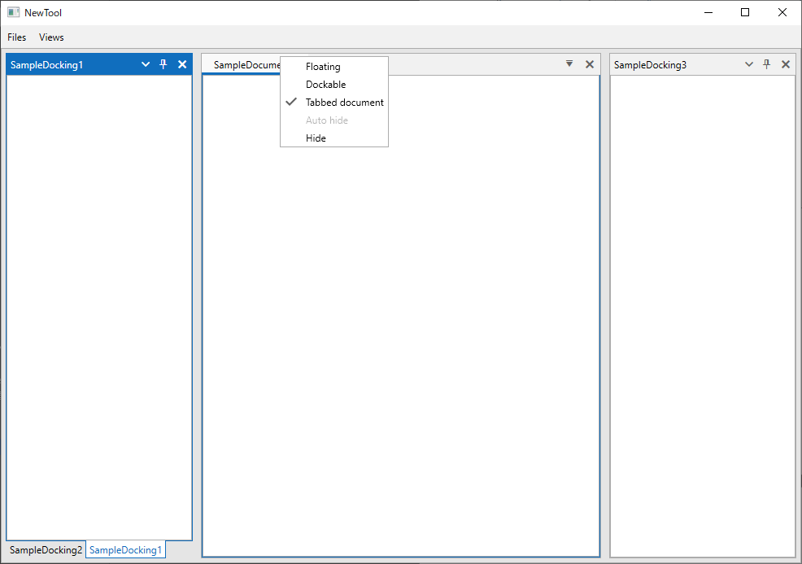

#### 3.2.3.5 内部処理（状態遷移、シーケンス）

##### 状態一覧

| 状態No. | 状態名 | 状態の説明 | 画面表示 | 操作可否 |
|---|---|---|---|---|
| ST-001 | Floating | 単一のウィンドウで、ドッキング不可 | 独立ウィンドウ | 可 |
| ST-002 | Dockable | ドッキング可能な状態 | ドッキング領域またはフローティング | 可 |
| ST-003 | Tabbed document | ドキュメント領域にドッキングした状態 | タブ表示 | 可 |
| ST-004 | 編集中 | ドキュメントに未保存の変更がある状態 | タイトルに「*」を付けて表示 | 可 |

##### 状態遷移

| No. | 遷移前状態 | イベント | ガード条件 | 処理 | 遷移後状態 |
|---:|---|---|---|---|---|
| 1 | Dockable | ドキュメントタブを選択 | 常時 | ドキュメント領域へ配置する | Tabbed document |
| 2 | Floating | ドッキングを選択 | 常時 | ドッキング可能にする | Dockable |
| 3 | 編集中 | ドキュメントを閉じる | 未保存変更あり | 保存確認画面を表示する | 保存確認中 |
| 4 | 編集なし | ドキュメントを閉じる | 常時 | ドキュメントを閉じる | 画面なし |

##### 処理シーケンス

| 手順 | 実行主体 | 処理 | 入力 | 出力 | 異常時の動作 |
|---:|---|---|---|---|---|
| 1 | ユーザー | 未保存のドキュメントを閉じる | 対象ドキュメント | 保存確認要求 | - |
| 2 | YCEStudio | ドキュメント保存確認画面を表示する | 未保存ドキュメント一覧 | ユーザー選択待ち | 3.2.4を参照 |
| 3 | 呼出元 | 選択結果に応じて保存、破棄または終了取消を行う | ボタン選択結果 | 処理結果 | - |  

#### 3.2.3.6 メッセージ
##### 3.2.3.6.1 保存確認メッセージ
- 保存確認メッセージは3.2.4を参照。
  - 保存：各ドキュメントを保存し、閉じる。
  - 保存しない：保存せずにドキュメントを閉じる。
  - キャンセル：ドキュメントを閉じない。

#### 3.2.3.7 リソース

| リソースID | 使用箇所 | 日本語 | 英語 | 簡体字 | 備考 |
|---|---|---|---|---|---|
| RES-001 | コンテキストメニュー | フローティング(_F) | _Floating | 悬浮(_F) |  |
| RES-002 | コンテキストメニュー | ドッキング(_D) | _Dockable | 停靠(_D) |  |
| RES-003 | コンテキストメニュー | ドキュメントタブ(_T) | _Tabbed document | 文档选项卡(_T) |  |
| RES-004 | コンテキストメニュー | 閉じる(_C) | _Close | 关闭(_C) |  |
| RES-005 | コンテキストメニュー | 全て閉じる(_A) | Close _All | 全部关闭(_A) |  |
| RES-006 | コンテキストメニュー | 他を全て閉じる(_O) | Close _Others | 关闭其他(_O) |  |

### 3.2.4 ドキュメント保存確認画面

#### 3.2.4.1 画面構成

##### 画面イメージ

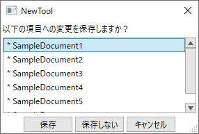

##### 画面レイアウト

| 領域No. | 領域名 | 概要 | コンテキストメニューNo. |
| --- | --- | --- | --- |
| 1 | 説明 | 説明を表示する | - |
| 2 | 未保存ドキュメント一覧 | 未保存のドキュメント一覧を表示する | - |
| 3 | 保存 | 未保存のドキュメントを全て保存する | - |
| 4 | 保存しない | 未保存のドキュメントを保存しない | - |
| 5 | キャンセル | キャンセルする | - |
| 6 | × | キャンセルする | - |

#### 3.2.4.2 メニューバー

なし

#### 3.2.4.3 コントロール仕様

| No. | コントロール名 | 種別 | 表示内容・用途 | 初期値 | 入出力 | 有効条件 | 表示条件 | リソースNo. |
|---:|---|---|---|---|---|---|---|---|
| 1 | 説明 | テキストブロック | 保存確認メッセージを表示する | - | 出力 | 常時無効 | 常時表示 | RES-001 |
| 2 | 未保存ドキュメント一覧 | リストビュー | 未保存ドキュメントを一覧表示する | 対象ドキュメント | 出力 | 常時有効 | 常時表示 | - |
| 3 | 保存 | ボタン | 未保存ドキュメントを保存する | - | 入力 | 常時有効 | 常時表示 | RES-002 |
| 4 | 保存しない | ボタン | 保存せずに終了する | - | 入力 | 常時有効 | 常時表示 | RES-003 |
| 5 | キャンセル | ボタン | 終了をキャンセルする | - | 入力 | 常時有効 | 常時表示 | RES-004 |
| 6 | × | ボタン | キャンセルする | - | 入力 | 常時有効 | 常時表示 | - |

##### マウス操作

| No. | マウス操作 | 対象 | 動作 | 有効条件 |
|---:|---|---|---|---|
| 1 | クリック | ダイアログ内のコントロール | コントロールを選択する | 有効 |
| 2 | ダブルクリック | ダイアログ | - | 無効 |
| 3 | 右クリック | ダイアログ | -（タイトルバーはWindows標準） | 無効 |
| 4 | ドラッグ | ダイアログ | - | 無効 |
| 5 | ドロップ | ダイアログ | - | 無効 |

##### キーボード操作

| No. | キー操作 | 対象 | 動作 | 有効条件 |
|---:|---|---|---|---|
| 1 | Enter | 選択中のボタン | 選択中のボタンを実行する | 有効 |
| 2 | Delete | ダイアログ | - | 無効 |
| 3 | BackSpace | ダイアログ | - | 無効 |
| 4 | Ctrl + X | ダイアログ | - | 無効 |
| 5 | Ctrl + C | ダイアログ | - | 無効 |
| 6 | Ctrl + V | ダイアログ | - | 無効 |
| 7 | Ctrl + Z | ダイアログ | - | 無効 |
| 8 | Ctrl + N | ダイアログ | - | 無効 |
| 9 | Esc | ダイアログ | キャンセルボタンを実行する | 有効 |

#### 3.2.4.4 コンテキストメニュー

なし

#### 3.2.4.5 内部処理（状態遷移、シーケンス）

##### 状態一覧

| 状態No. | 状態名 | 状態の説明 | 画面表示 | 操作可否 |
|---|---|---|---|---|
| ST-001 | 確認待ち | 未保存ドキュメントと選択肢を表示する | 保存確認ダイアログ | ボタン選択可 |
| ST-002 | 結果返却済み | 選択結果を呼出元へ返した状態 | ダイアログを閉じる | 不可 |

##### 状態遷移

| No. | 遷移前状態 | イベント | ガード条件 | 処理 | 遷移後状態 |
|---:|---|---|---|---|---|
| 1 | 確認待ち | 保存を選択 | 常時 | 保存結果を呼出元へ返す | 結果返却済み |
| 2 | 確認待ち | 保存しないを選択 | 常時 | 保存しない結果を呼出元へ返す | 結果返却済み |
| 3 | 確認待ち | キャンセルまたは×を選択 | 常時 | キャンセル結果を呼出元へ返す | 結果返却済み |

##### 処理シーケンス

| 手順 | 実行主体 | 処理 | 入力 | 出力 | 異常時の動作 |
|---:|---|---|---|---|---|
| 1 | 呼出元 | 保存確認画面を表示する | 未保存ドキュメント一覧 | ダイアログ | - |
| 2 | ユーザー | 保存、保存しない、キャンセルのいずれかを選択する | ボタン操作 | 選択結果 | - |
| 3 | ダイアログ | 選択結果を呼出元へ返す | 選択結果 | 戻り値 | - |
| 3 | 呼び出し元 | 選択結果に応じて処理 | - | - | - |

- 本画面の機能として、ボタン実行時に処理は行わない。画面呼び出し元にどのボタンが押下されたかの結果のみを返し、呼び出し元で処理する。

#### 3.2.4.6 メッセージ

なし

#### 3.2.4.7 リソース

| リソースID | 使用箇所 | 日本語 | 英語 | 簡体字 | 備考 |
|---|---|---|---|---|---|
| RES-001 | 説明 | 以下の項目への変更を保存しますか？ |  |  |  |
| RES-002 | 保存ボタン | 保存 |  |  |  |
| RES-003 | 保存しないボタン | 保存しない |  |  |  |
| RES-004 | キャンセルボタン | キャンセル |  |  |  |

### 3.2.5 ラダープログラム作成、プロパティ画面

※後日、ラダープログラム側の仕様書に記載する。変更点のみ記載する。

<T.B.D>言語の表示条件は、$PCDEFにキーを追加？

<T.B.D>ST言語用のアイコンに変更？ナビゲーションウィンドウやプログラム選択画面のアイコンにも影響がある。

<T.B.D>ラダープログラムではなく、ST言語も含めた名称にする必要がある。スキャンプログラムなど。

#### 3.2.5.1 画面構成

##### 画面イメージ

- プログラム新規作成画面


- プログラムプロパティ画面


##### 画面レイアウト

| 領域No. | 領域名 | 概要 | コンテキストメニューNo. |
| --- | --- | --- | --- |
| 1 | 言語(ラベル) | ラベルを表示する。 | - |
| 2 | 言語(コンボ) | 言語を選択する。 | - |

#### 3.2.5.2 メニューバー

変更なし（既存のMPE720仕様に従う）

#### 3.2.5.3 コントロール仕様

| No. | コントロール名 | 種別 | 表示内容・用途 | 初期値 | 入出力 | 有効条件 | 表示条件 | リソースNo. |
|---:|---|---|---|---|---|---|---|---|
| 1 | 言語(ラベル) | ラベル | 言語項目名を表示する | - | 出力 | 常時無効 | 常時表示 | RES-001 |
| 2 | 言語(コンボ) | コンボボックス | ラダー/STを選択する | ラダー | 入出力 | 新規作成時のみ有効 | 常時表示 | RES-002,RES-003 |

##### マウス操作

既存のMPE720操作仕様に従う。本画面での変更点はない。

##### キーボード操作

既存のMPE720操作仕様に従う。本画面での変更点はない。

#### 3.2.5.4 コンテキストメニュー

変更なし

#### 3.2.5.5 内部処理（状態遷移、シーケンス）

##### 状態一覧

既存のMPE720仕様に従う。本書では変更点以外の状態定義を行わない。

##### 状態遷移

既存のMPE720仕様に従う。本書では変更点以外の状態遷移を定義しない。

##### 処理シーケンス

既存のMPE720仕様に従う。本書では変更点以外の処理シーケンスを定義しない。

#### 3.2.5.6 メッセージ

変更なし（既存のMPE720仕様に従う）

#### 3.2.5.7 リソース

| リソースID | 使用箇所 | 日本語 | 英語 | 簡体字 | 備考 |
|---|---|---|---|---|---|
| RES-001 | 言語ラベル | 言語 |  |  |  |
| RES-002 | 言語コンボボックス | ラダー |  |  |  |
| RES-003 | 言語コンボボックス | ST |  |  |  |

## 3.3 ファイルデータ仕様

### 3.3.1 ファイル一覧

| ファイルNo. | ファイル名 | 形式 | 用途 | 入出力 | 保存先 | 文字コード |
|---|---|---|---|---|---|---|
| FILE-001 | $Gx | DWGプログラムデータ | ラダー、ST言語プログラムを保持する | 入出力 | ProjectFilePathで指定されるプロジェクト | ST言語プログラムパケットは、UTF-8。左記以外は既存通り。 |
| FILE-002 | $PROMAPx | DWGマップデータ | ラダー、ST言語プログラムのマップ情報を保持する | オンライン時はコントローラが生成 | プロジェクト／コントローラ側 | Shift-JIS |
| FILE-003 | $FUNCMAP | 関数マップデータ | 関数、ST言語プログラムの関数マップ情報を保持する | オンライン時はコントローラが生成 | プロジェクト／コントローラ側 | Shift-JIS |

### 3.3.2 $GX

#### データ構造（ソースファイル）

- <T.B.D>STプログラム用の新規パケットを追加する

| Item | PKID | PKNO | 項目 | Size | 備考 |
|---|---|---|---|---|---|
| DWG | T.B.D | T.B.D | ST言語プログラム用パケット | T.B.D | パケットIDはコントローラ側と要調整 |

#### パケット構造

##### ST言語プログラム用パケット（PKID: T.B.D）

- <T.B.D>

| Addr. | 項目 | Size<br>(byte) | 初期値 | 備考 |
|---|---|---|---|---|
| T.B.D | パケット識別情報 | T.B.D | T.B.D | パケットIDはコントローラ側と要調整 |
| T.B.D | ST言語プログラムデータ | T.B.D | T.B.D | 新規パケットの詳細は未確定 |

### 3.3.3 $PROMAPX / $FUNCMAP

- ST言語か既存のラダーかは、ST言語用のパケット有無で判断する。
- オフライン時は、MPE720で生成しているが、オンライン時のコントローラ側で生成しているため、コントローラ側でも対応が必要。

# 4. 内部仕様

### 設計方針

- MVVM設計パターン
- CommunityToolkit.Mvvmを利用する。
- 原則、コードビハインド(xaml.cs)にコードは記述しない。
  - ただし、外部コンポーネントの特殊な処理やコードビハインドに記述したほうが簡素で保守しやすい場合は、記述可能とする。
- 依存関係(DI)挿入設計パターン
  - Microsoft.Extensions.DependencyInjectionを利用する。  
※依存が必要なクラス、インターフェースをコンストラクタで挿入すること。ServiceProviderなど大元を挿入しない。  
※Ioc.Default(DIコンテナへ静的アクセス)は基本的に使用禁止であるが、View層(BehaviorやMarkupExtension)であれば、使用可能とする。
- デバッグ用ログ
  - 不具合調査などを容易にするため、ログを出力する。
  - Microsoft.Extensions.Logging、NLogを利用する。
  - 最低限以下はログ出力を行うこと。
    - 画面の起動、終了
    - 例外発生
    - メモリの確保、解放
- アニメーション
- UIコントロールのアニメーションは視認性が悪いため、基本的に無効とする。
- 特に、telerikコントロールを使用する場合、アニメーションが実装されていることが多い。
- App.xaml.csでtelerikコントロールのアニメーションを無効化しているが、実装箇所でアニメーションが行われていないか確認すること。
- 不要なusingは削除
  - 使用する名前空間をusingで記述する際、不要なものは削除する。
  - 新規ファイルの場合、デフォルトでusingが記述されている。
- nugetパッケージのバージョンは中央パッケージ管理 (CPM)を行う
  - プロジェクトが利用するパッケージのバージョンを統一する目的

### フォルダ構成

```
ControllerEngineering
├docs
│└仕様書など
├Directory.Packages.props ← Yaskawa.ControllerEngineeringに関連するソリューションやプロジェクトのnugetパッケージの管理ファイル
├YCEStuido ← YCEStudio関連フォルダ
│├ControllerEngineeringStudio.sln ← YCEStudioのソリューション
│├ControllerEngineeringStudio.App ← YCSStudioのメインソフォルダ
││・・・
│├ControllerEngineeringStudio.Core ← YCEStudioのCoreプロジェクトフォルダ
│・・・
├YCEService
├AllBuild.bat ← 関連ソリューションの一括ビルド
└bin  
　├Debug
　│└ControllerEngineering
　│　└ビルド結果
　└Release
　　└...
```

### ビルド

- 本アプリは、x86をサポートしないため、AnyCPUでビルドする。
- MPE720との連携確認時は、ビルド結果`ControllerEngineeringフォルダ`をDebug2017/Release2017にコピーする。

※<要検討>今後、MPPartsなども本アプリをベースにビルドすることになるので、検討が必要。

### アーキテクチャ

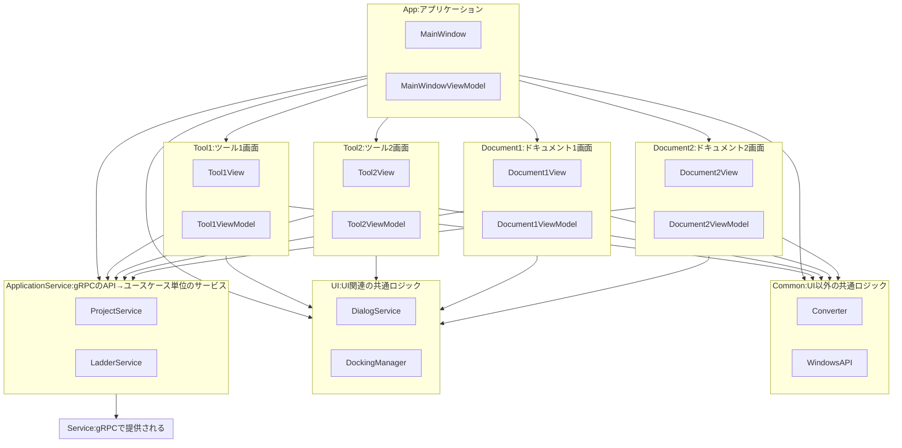

| No. | 項目 | 概要 |
| --- | --- | --- |
| 1 | App | アプリケーションのメインプロジェクト。どこからも参照されない。 |
| 2 | UI | UIの共通ロジックを持つプロジェクト。どこからでも参照可能。例：Dialog、Dockingなど |
| 3 | Common | UI以外の共通ロジックを持つプロジェクト。どこからでも参照可能。メッセージ通信、レジストリパスなど |
| 4 | Tool | ツール画面のプロジェクト。機能ごとにプロジェクトを分ける。ツール画面の呼び出し元からのみ参照可能。 |
| 5 | Document | ドキュメント画面のプロジェクト。機能ごとにプロジェクトを分ける。ドキュメント画面の呼び出し元からのみ参照可能。 |
| 6 | ApplicationService | gRPCのAPIをユースケース単位のサービスにする。例：プロジェクトを開く、保存、ラダープログラムを作成する、開くなど |
| 7 | Service | gRPC機能を使用したService本体 |

### Docking

#### 主要クラス

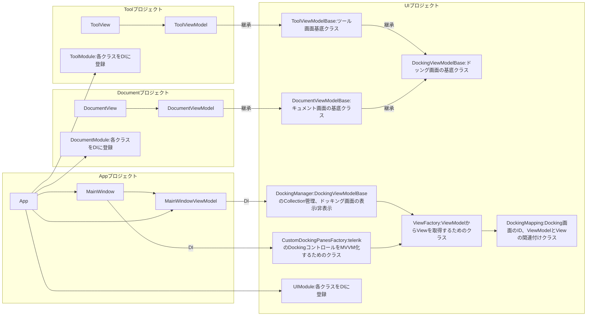

| No. | 項目 | 概要 |
| --- | --- | --- |
| 1 | DockingManager | DockingViewModeBaseをCollectionで管理する。ツール画面やドキュメント画面の表示/非表示などは本クラスを必ず使用する必要がある。 |
| 2 | ToolViewModelBase | ツール画面を作成する場合、必ず継承する |
| 3 | DocumentViewModelBase | ドキュメント画面を作成する場合、必ず継承する |
| 4 | ○○Module | プロジェクトごとに作成。同一プロジェクト内のクラスをDIに登録するためのクラス。 |
|   |   |   |

#### ツール画面/ドキュメント画面の実装手順

1. ControllerEngineering.UI.DockingのDockingIdに追加する画面のIDを定義
2. 新規プロジェクトを作成(ControllerEngineering.○○)
3. ViewModelでToolViewModelBaseもしくは、DocumentViewModelBaseを継承
4. XamlのコントロールはUserControlにする
5. ○○Module.csを作成し、IModuleを継承
6. ○○ModuleでRegisterServicesを実装し、AddDocking()で、ViewModelやViewをDI登録する

### Dialog

#### 主要クラス

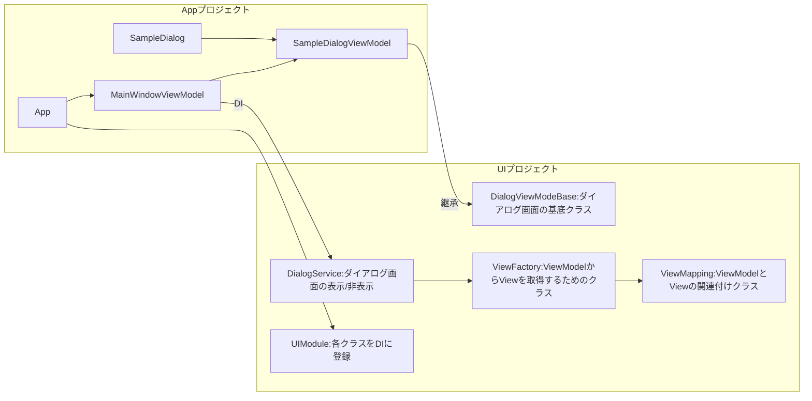

| No. | 項目 | 概要 |
| --- | --- | --- |
| 1 | SampleDialog/SampleDialogViewModel | ダイアログ実装クラス |
| 2 | DialogViewModelBase | ダイアログの基底クラス |
| 3 | DialogService | メッセージボックスやダイアログの表示を行うViewModelを引数に、ViewFactory経由でViewを生成するViewのDataContextにViewModelを設定し、Showする |
|   |   |   |

#### ダイアログ画面の実装手順

1. ダイアログを作成するプロジェクトでViewとViewModelを生成
2. ViewModelでControllerEngineering.UI.DialogのDialogViewModeBaseを継承
3. ViewのXamlのコントロールはUserControlにする
4. ○○ModuleでRegisterServicesを実装し、AddDialog()で、ViewModelやViewをDI登録する

### UIの機能間連携

- UI間の連携はIMessengerを用いて行う。
- メッセンジャーはCommunity.Toolkit.MvvmのWeakReferenceMessengerを使用する。

#### 送信側の例：
- コンストラクタでIMessengerをInjection
```charp
public DockingManager(IViewFactory viewFactory, IEnumerable<IDockingMapping> mappings, ILogger<DockingManager> logger, IMessenger messenger)
```

- IMessengerでメッセージ送信
```csharp
var message = new DockingStateChangedMessage(vm.DockingId, vm.Key, vm.IsHidden);
_messenger.Send(message);
```
### 受信側の例：
- ObservableRecipient、IRecipientを継承する
  - IRecipientに指定するのは、受信するメッセージの型
```csharp
public partial class MenuItemViewModel : ObservableRecipient
```
```csharp
public partial class ViewMenuItemViewModel : MenuItemViewModel, IRecipient<DockingStateChangedMessage>
```
- コンストラクタでIMessengerをInjectionし、IsActiveをtrueにして受信登録
```csharp
public ViewMenuItemViewModel(IMessenger messenger) : base(messenger)
```
- IRecipientの関数を実装する
``` csharp
public void Receive(DockingStateChangedMessage message)
{
  // ドッキング画面の表示/非表示状態をメニューのチェック状態に反映する
  if (Parameter.DockingId == message.DockingId
    && Parameter.Key == message.Key)
  {
    IsChecked = !message.IsHidden;
  }
}
```

### デバッグ用ログ出力

- <T.B.D>ログの出力先や容量が決まってから対応するため、初版未対応。CRA用操作ログのみ出力する？

- 以下のようにツールの操作ログを日時ごとに出力する。

```
C:\Users\○○\AppData\Local\YASKAWA\Yaskawa.ControllerEngineeringStudio\Logs
├2026-07-01.log
└2026-07-02.log
```

- ログ出力内容は以下のフォーマットとする。  
`datetime[level][class][message][exception]`

| No. | 項目 | 概要 |
| --- | --- | --- |
| 1 | datetime | 発生日時 |
| 2 | level | ログのレベル<br>INFO：情報<br>WARN：警告<br>ERROR：エラー<br>Fatal：致命的エラー |
| 3 | class | ログ出力クラス名 |
| 4 | message | ログメッセージ |
| 5 | exception | 例外情報 |

### UnitTest

<T.B.D>ロジックの自動テストを実装する。